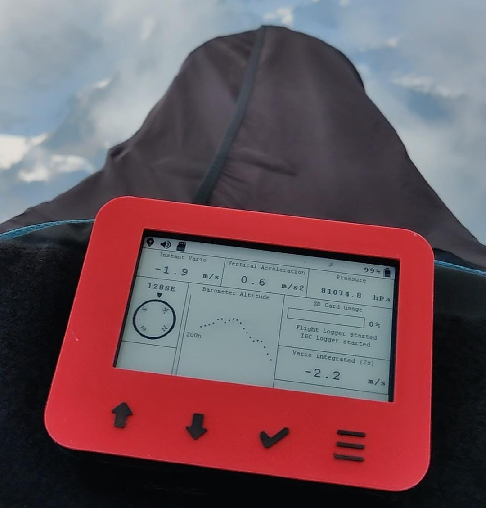
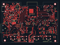
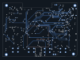
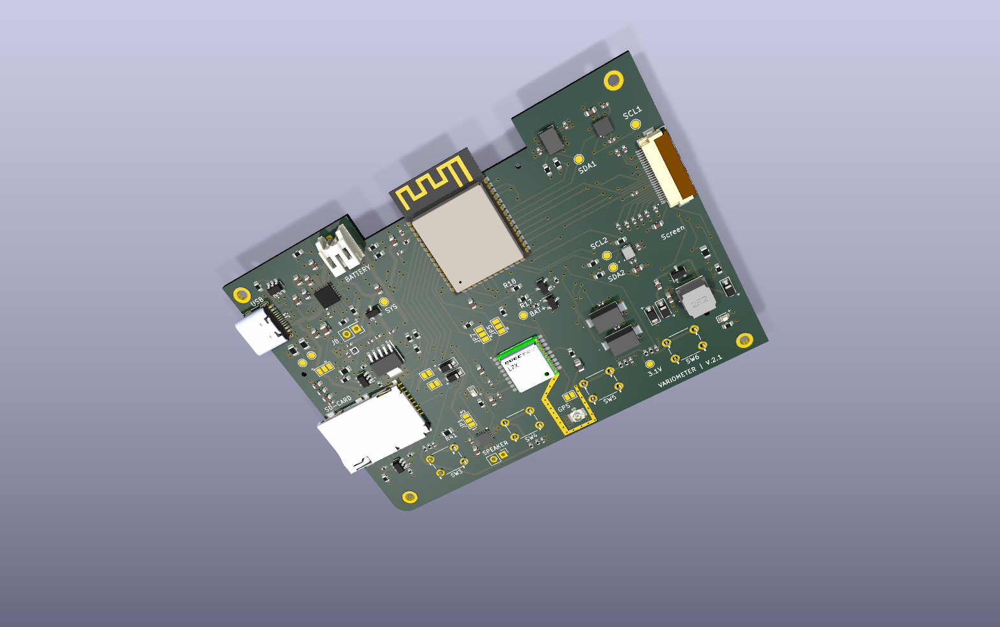
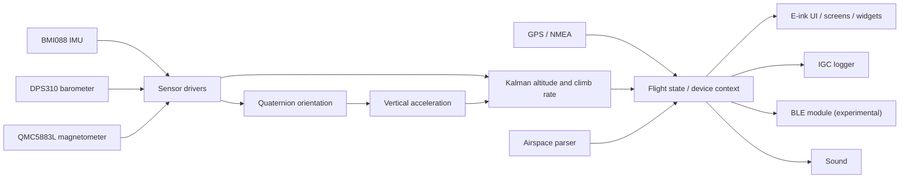
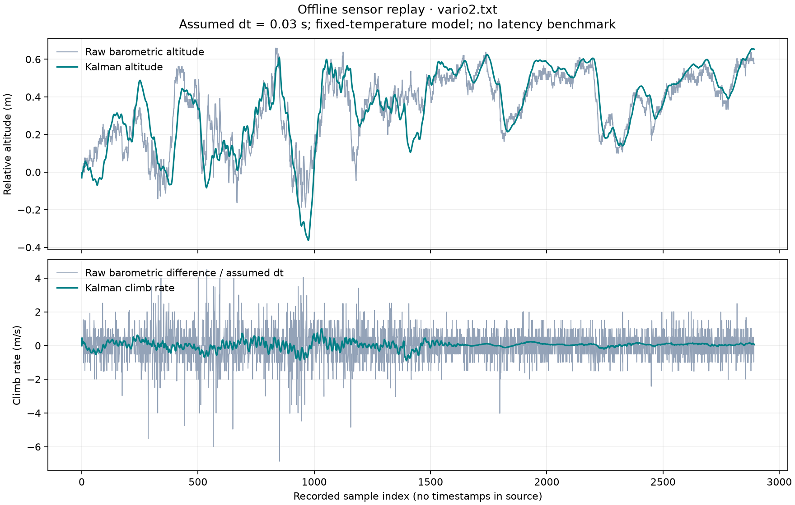
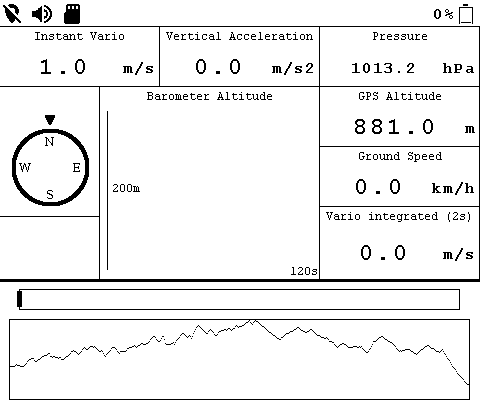
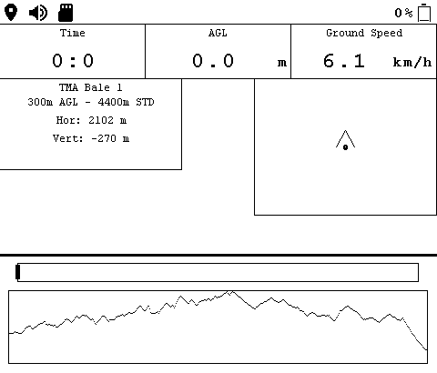
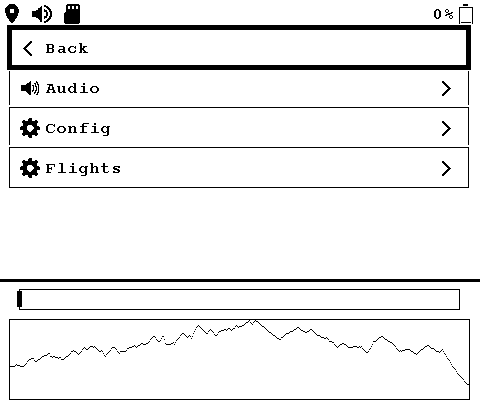
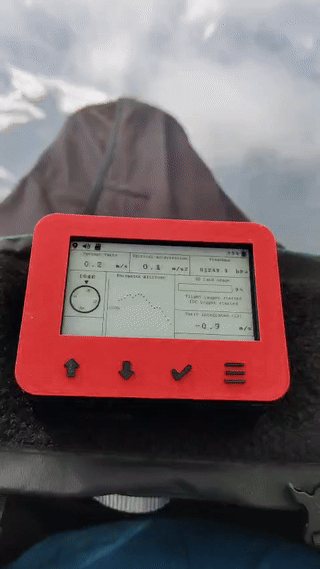

# VariometerV2

A paragliding variometer built from custom KiCad PCBs, ESP32 firmware, sensor fusion, and an e-ink flight interface.



Built and tested on the device, including in flight. [Watch the flight video](docs/media/flight.mp4).

I started this project in 2021 as my **Maturarbeit** (Swiss high-school thesis), then continued developing it independently through 2024. My work spans PCB design, sensor integration, estimation, and the application’s rendering system, screens, and widgets. The enclosure/CAD work combines contributions from my brother and me. Third-party foundations are credited below.

## Features

- Three custom PCB revisions designed in KiCad.
- ESP32 firmware, primarily C, on ESP-IDF and FreeRTOS.
- BMI088 IMU, DPS310 barometer, and QMC5883L magnetometer; quaternion orientation estimation and a Kalman filter combining barometric altitude with acceleration.
- GPS/NMEA input, IGC flight logging, airspace parsing, sound output, an experimental BLE module, and watchdog support.
- E-ink UI with a custom rendering system, screens, and widgets.
- Sensor mocks, a FreeRTOS host simulation, a Linux screen simulator, and recorded-sensor replay for analysis.

## Hardware

### Latest revision

These exports show the PCB in `Hardware/Version 2.1/`. The bottom view is mirrored; they show copper and silkscreen rather than assembled-board photographs.

| Front / top | Back / bottom |
| --- | --- |
|  |  |



Rendered from the archived board and available component models; these are design views, not photographs.

The [schematic overview](docs/images/schematic-2.1/VariometerV2.2.1.svg) connects the main subsystems. Individual sheets: [power](docs/images/schematic-2.1/VariometerV2.2.1-Power.svg), [sensors](docs/images/schematic-2.1/VariometerV2.2.1-Devices.svg), [display](docs/images/schematic-2.1/VariometerV2.2.1-Screen.svg), and [peripherals](docs/images/schematic-2.1/VariometerV2.2.1-Peripherals.svg).

### Revision history

The revision labels follow the archive’s directories. Each retains editable KiCad source.

| Revision | Design files | PCB views | Schematic |
| --- | --- | --- | --- |
| 1.0 | [Hardware/Version 1.0](Hardware/Version%201.0/) | [Top](docs/images/pcb-1.0-top.svg) · [bottom](docs/images/pcb-1.0-bottom.svg) · [3D](docs/images/pcb-1.0-3d.png) | [SVG](docs/images/schematic-1.0/VariometerV2.svg) |
| 2.0 | [Hardware/Version 2.0](Hardware/Version%202.0/) | [Top](docs/images/pcb-2.0-top.svg) · [bottom](docs/images/pcb-2.0-bottom.svg) · [3D](docs/images/pcb-2.0-3d.png) | [SVG](docs/images/schematic-2.0/VariometerV2.2.svg) |
| 2.1 | [Hardware/Version 2.1](Hardware/Version%202.1/) | [Top](docs/images/pcb-2.1-top.svg) · [bottom](docs/images/pcb-2.1-bottom.svg) · [3D](docs/images/pcb-2.1-3d.png) | [SVG overview](docs/images/schematic-2.1/VariometerV2.2.1.svg) |

`Case/` contains enclosure designs and printing exports. Regenerate the board and schematic SVGs with:

```sh
python3 tools/export_kicad.py
```

The exports and angled renders were generated with **KiCad 9.0.9**. Install KiCad’s standard 3D models as well; `--models /path/to/3dmodels` selects a custom location. The script resolves old model paths in temporary copies and records unresolved references in `docs/images/pcb-render-manifest.json`. KiCad 7/8 can export SVGs; `pcb render` requires KiCad 9+. See the [KiCad CLI reference](https://docs.kicad.org/9.0/en/cli/cli.html).

## Firmware architecture



`main/MainTasks.c` defines **Measure Height**, **Measure Acceleration**, and **Kalman Filter**. The barometer task notifies the filter; the acceleration task updates orientation and queues vertical acceleration; the filter updates shared flight state. Queues, task notifications, and mutexes connect them.

Rendering and display refresh run in separate tasks. GPS parsing, IGC logging, button input, battery management, sound, storage checks, and airspace parsing have their own task entry points. BLE remains experimental and its startup call is disabled in the archived configuration. The diagram shows module relationships; the configuration and startup code determine which modules run.

### Folder map

| Path | Purpose |
| --- | --- |
| `Software/variometer-software/main/Sensor/` | Sensor drivers and simulation implementations |
| `main/QuaternionFilter.c`, `main/Kalman/` | Orientation and altitude/climb-rate estimation |
| `main/DeviceContext.*`, `main/FlightState.*` | Shared state and flight-state logic |
| `main/Screen/` | Render system, screens, widgets, e-ink integration |
| `main/IGC/`, `main/nmea_parser.*` | Flight logging and GPS parsing |
| `main/AirspaceParcer/`, `main/Bluetooth/`, `main/Watchdog/` | Airspace, BLE, watchdog |
| `Simulation/Main/` | FreeRTOS host runner and ESP-IDF mocks |
| `Screen_Simulator_Linux/`, `Screen_Simulator/` | Linux UI simulator and earlier Windows version |
| `VariometerAnalysis/` | Analysis and offline replay |
| `Hardware/`, `Case/`, `Documentation/` | Electronics, enclosure, design notes |
| `Website/` | Supporting web experiments |

Paths beginning with `main/` are relative to `Software/variometer-software/`.

## Simulation & replay

### Clone

```sh
git clone --recurse-submodules https://github.com/oiver12/VariometerV2.git
cd VariometerV2
```

For an existing clone, run `git submodule update --init --recursive` from the root. The primary firmware is in `Software/variometer-software/`. The archived FreeRTOS runner retains a separate checkout at `Simulation/Main/variometer-software/`, pinned to its historical firmware version.

### Offline sensor replay

From the repository root, with Python and GCC available:

```sh
python3 -m venv .venv
. .venv/bin/activate
python -m pip install -r VariometerAnalysis/requirements.txt
python VariometerAnalysis/replay_flight.py \
  Simulation/Main/VarioLogs/vario2.txt \
  --dt 0.03 --allow-truncated-tail \
  --output docs/images/flight-replay.png
```



The script compiles the firmware’s existing quaternion and Kalman functions into a temporary host library and feeds in recorded acceleration, angular velocity, magnetic field, and pressure. The upper panel compares relative barometric altitude with the Kalman estimate; the lower compares an unsmoothed barometric difference with estimated climb rate.

The raw log has **no timestamps**. `--dt` is an explicit assumption; the horizontal axis is sample index. The script uses the firmware’s fixed-temperature pressure conversion, discards an incomplete final record only when requested, and writes a JSON file recording its assumptions and input hash. It does not reproduce task scheduling, startup warm-up, or sensor calibration, and is not a latency benchmark.

### FreeRTOS sensor mocks

With `ISSIMULATION` defined, hardware reads are replaced by `BMI088_Simulation.c`, `QMC588L_Simulation.c`, and the historically named `DPS310_SImulation.c`. These call `Simulation/Main/simulationData.c`, which supplies sensor samples and GPS updates from `VarioLogs/`. ESP-IDF mocks provide host interfaces; the bundled FreeRTOS POSIX port schedules application tasks.

On Debian/Ubuntu, install GCC, Make, SDL2 headers, and pkg-config (`build-essential`, `libsdl2-dev`, `pkg-config`). Then:

```sh
cd Simulation/Main
make clean
make -j2 SANITIZE_ADDRESS=1 USER_DEMO=FULL_DEMO
ASAN_OPTIONS=detect_leaks=0 ./build/posix_demo
```

The sanitizer build is the validated host replay configuration; the archived optimized build remains unstable. The runner defaults to `VarioLogs/vario2.txt` and `VarioLogs/gps2.txt`, warns about incomplete final records, and exits at the end of the sensor recording. Select another pair with:

```sh
VARIO_REPLAY_VARIO=VarioLogs/vario.txt \
VARIO_REPLAY_GPS=VarioLogs/gps.txt \
ASAN_OPTIONS=detect_leaks=0 ./build/posix_demo
```

Host timing is not an embedded performance measurement. The archived mocks do not implement every hardware service.

### Screen simulator

```sh
cd Screen_Simulator_Linux
make
make run
```

Use up/down arrows to change screens, `m` for the menu/power button, Enter to select, `p` for a popup, and `f` to advance replay. The IGC recording is selected in `main.c`.

| Flight layout | Navigation layout | Settings |
| --- | --- | --- |
|  |  |  |

These are captures of the desktop renderer. Regenerate them from the root after building with `python tools/capture_screens.py`.

## Build & flash

Use **ESP-IDF v5.1.4** with the **ESP32-S3** target. This version was built successfully during repository preparation and is pinned in `main/idf_component.yml` and `dependencies.lock`.

For a new SDK installation (outside this repository):

```sh
git clone --branch v5.1.4 --recursive https://github.com/espressif/esp-idf.git
cd esp-idf
./install.sh esp32s3
. ./export.sh
```

Return to the project checkout, then build and flash:

```sh
cd Software/variometer-software
idf.py build
# Substitute your device's serial port.
idf.py -p /dev/ttyUSB0 flash monitor
```

For later shell sessions, activate the SDK with `. /path/to/esp-idf/export.sh` before building. The checked-in `sdkconfig` already selects ESP32-S3; review `main/pinDefines.h` and the PCB revision before flashing. See [Espressif’s v5.1.4 setup guide](https://docs.espressif.com/projects/esp-idf/en/v5.1.4/esp32s3/get-started/index.html).

The archived binary identifies the historical development SDK as `v5.1-dev-4557-gf404fe96b1-dirty`; the old 4.4.3 lockfile was stale. The stable version above is the reproducible build baseline.

## From Maturarbeit to V2

The original 2021 high-school thesis version is preserved in [oiver12/Variometer-Maturarbeit](https://github.com/oiver12/Variometer-Maturarbeit). I continued independently after the thesis, developing the electronics, firmware, interface, and desktop tools through 2024. V2 records that continued work across hardware and software.

## Third-party code & license

Existing libraries and reference implementations are credited here and in [THIRD_PARTY_NOTICES.txt](THIRD_PARTY_NOTICES.txt). Their notices and license files remain with the source.

| Code | Credit and license status |
| --- | --- |
| `main/nkolban/` | Neil Kolban / esp32-snippets contributors; upstream Apache-2.0 license included |
| `main/Screen/E_Ink/` and simulator copies | Waveshare driver and GUI_Paint, with STMicroelectronics bitmap fonts from that package; restored upstream font notices |
| `main/Screen/FIFO.*` and simulator copies | Jesús Rubén Santa Anna Zamudio / Geek Factory; **GPL-3.0-or-later** notices; GPL text included |
| `main/nmea_parser.*` | Espressif Systems; Apache-2.0 notices |
| `main/crc/` | Michael Barr; public-domain dedication with retained notice |
| `main/IGC/IGC_Parser.*` | Source credits ezgliding/goigc; upstream Apache-2.0 license included; adaptation provenance to confirm |
| `main/Kalman/Quaternion/` | Adapted Freescale sensor fusion via Paul Stoffregen’s NXPMotionSense; BSD-3-Clause notice restored |
| `main/Kalman/` matrix/Cholesky routines | Markus Mayer / kalman-clib (MIT), with EJML references; upstream license restored |
| `main/compass.c` | References SkyDrop; original upstream is unavailable and provenance remains unresolved |
| `Simulation/FreeRTOS/` | FreeRTOS/Amazon, Percepio trace recorder, and bundled dependencies; per-component licenses retained |
| Windows simulator and analysis dependencies | cJSON (Dave Gamble and contributors), SDL, packaged .NET dependencies; existing notices retained |

**My original software is licensed under [MIT](LICENSE).** Third-party code retains its own licenses, including the FIFO’s GPL-3.0-or-later obligations; the combined tree is not uniformly MIT-licensed. Enclosure/CAD contributions and third-party assets are outside this software license unless separately stated.

## Flight footage & photos

[](docs/media/flight.mp4)

The photograph and video show the assembled instrument on the harness during flight. The footage predates the pressure-label correction in this repository.

Optional additional photos:

- [ ] Assembled PCB close-up, showing the actual populated board.
- [ ] Assembled device on a neutral background, showing the enclosure and controls.

[PCB close-up placeholder](docs/images/photo-pcb-closeup-placeholder.svg).
