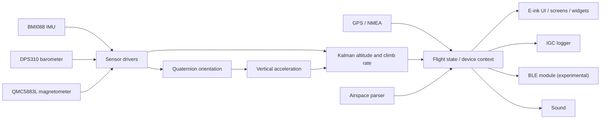

# VariometerV2

A paragliding variometer built from custom KiCad PCBs, ESP32 firmware, sensor fusion, and an e-ink flight interface.

Flight-tested on my paragliding harness. [Watch the flight video](docs/media/flight.mp4).

I started this project in 2021 as my [**Maturarbeit**](https://github.com/oiver12/Variometer-Maturarbeit) (Swiss high-school thesis), then continued developing it independently through 2024. I designed the custom PCBs and developed the firmware, sensor fusion pipeline, and e-ink rendering system, screens, and widgets. The enclosure/CAD work combines contributions from my brother and me.

## Features

- Three custom PCB revisions designed in KiCad.
- ESP32 firmware in C on ESP-IDF and FreeRTOS.
- BMI088 IMU, DPS310 barometer, and QMC5883L magnetometer; quaternion orientation estimation and a Kalman filter combining barometric altitude with acceleration.
- GPS/NMEA input, IGC flight logging, airspace parsing, sound output, an experimental BLE module, and watchdog support.
- E-ink UI with a custom rendering system, screens, and widgets.
- Sensor mocks, a FreeRTOS host simulation, a Linux screen simulator, and recorded-sensor replay for analysis.

## Hardware

### Latest revision: 2.1

| Front / top | Back / mirrored bottom |
| --- | --- |
|  |  |

[Schematic overview](docs/images/schematic-2.1/VariometerV2.2.1.svg) · [Power](docs/images/schematic-2.1/VariometerV2.2.1-Power.svg) · [Sensors](docs/images/schematic-2.1/VariometerV2.2.1-Devices.svg) · [Display](docs/images/schematic-2.1/VariometerV2.2.1-Screen.svg) · [Peripherals](docs/images/schematic-2.1/VariometerV2.2.1-Peripherals.svg)

### Revision history

| Revision | Design files | PCB views | Schematic |
| --- | --- | --- | --- |
| 1.0 | [Hardware/Version 1.0](Hardware/Version%201.0/) | [Top](docs/images/pcb-1.0-top.svg) · [bottom](docs/images/pcb-1.0-bottom.svg) · [3D](docs/images/pcb-1.0-3d.png) | [SVG](docs/images/schematic-1.0/VariometerV2.svg) |
| 2.0 | [Hardware/Version 2.0](Hardware/Version%202.0/) | [Top](docs/images/pcb-2.0-top.svg) · [bottom](docs/images/pcb-2.0-bottom.svg) · [3D](docs/images/pcb-2.0-3d.png) | [SVG](docs/images/schematic-2.0/VariometerV2.2.svg) |
| 2.1 | [Hardware/Version 2.1](Hardware/Version%202.1/) | [Top](docs/images/pcb-2.1-top.svg) · [bottom](docs/images/pcb-2.1-bottom.svg) · [3D](docs/images/pcb-2.1-3d.png) | [SVG overview](docs/images/schematic-2.1/VariometerV2.2.1.svg) |

`Case/` contains the enclosure designs and printing exports.

## Firmware architecture

The sensor fusion pipeline runs across FreeRTOS tasks: the barometer task notifies the Kalman filter, while the acceleration task updates orientation and queues vertical acceleration. The filter combines these inputs into shared flight state, using queues, task notifications, and mutexes to coordinate the tasks.

Rendering and e-ink refresh run in separate tasks. GPS parsing, IGC logging, button input, battery management, sound, storage checks, and airspace parsing have their own task entry points.

### Project structure

| Directory | Purpose |
| --- | --- |
| `Hardware/`, `Case/` | PCB revisions and enclosure designs |
| `Software/variometer-software/` | ESP32 firmware |
| `Simulation/Main/` | FreeRTOS host runner and sensor mocks |
| `Screen_Simulator_Linux/`, `Screen_Simulator/` | Desktop UI simulators |
| `VariometerAnalysis/` | Sensor-log analysis and offline replay |

## Simulation & replay

Sensor mocks replace hardware reads with recorded IMU, magnetometer, and pressure samples. A FreeRTOS simulation replays these recordings on a PC, allowing the firmware to run against recorded data.

The offline analysis tool runs the firmware’s quaternion and Kalman functions over the recorded sensor data:

Barometric altitude and climb rate compared with the Kalman estimate. The recording has no timestamps, so replay uses an assumed sample interval; this plot is not a latency benchmark.

The Linux screen simulator exercises the custom UI independently of the device:

| Flight layout | Navigation layout | Settings |
| --- | --- | --- |
|  |  |  |

[Replay and simulator instructions](docs/development.md#simulation--replay).

## Build & flash

**ESP32-S3 · ESP-IDF v5.1.4**

See the [developer guide](docs/development.md) for cloning, firmware build and flash commands, desktop simulation, and regenerating the visuals.

## Flight footage

## Third-party code & license

The project builds on FreeRTOS, Waveshare’s e-ink driver and GUI, STMicroelectronics bitmap fonts, Neil Kolban’s BLE library, Freescale/NXPMotionSense sensor fusion, kalman-clib, and other credited libraries. Full credits and license details are in [THIRD_PARTY_NOTICES.txt](THIRD_PARTY_NOTICES.txt).

**My original software is licensed under [MIT](LICENSE).** Third-party code retains its own licenses, including the FIFO’s **GPL-3.0-or-later** obligations; the combined tree is not uniformly MIT-licensed. Enclosure/CAD contributions and third-party assets are outside this software license unless separately stated.
